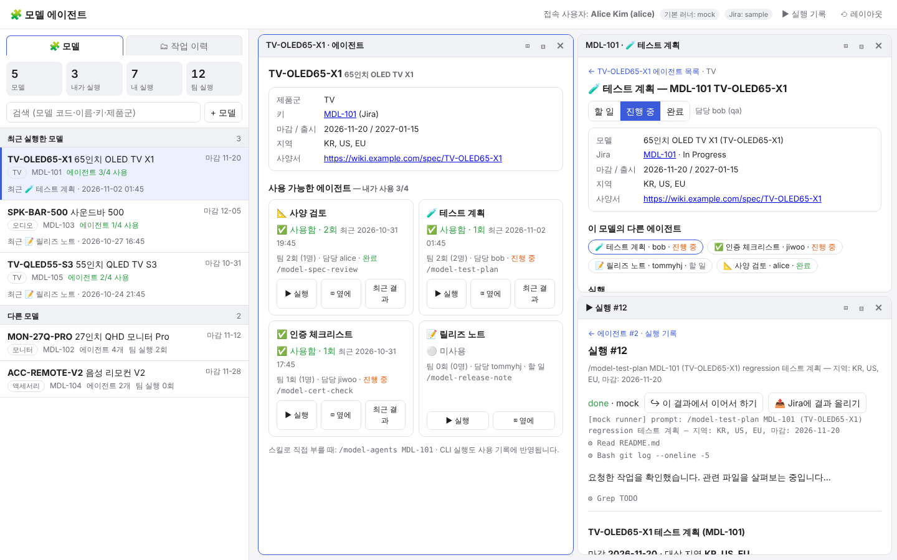

# Model agents as skills + UI (sample)

Work that used to start from Jira (Jira model registered → agents created) now runs as **skills**.
- Calling the skill shows **the models I ran first**.
- Clicking a model shows **the available agents and whether I have used each**, and you can run them from there.
- It works the same in chat (`/model-agents`) and in the web UI. It runs on Claude Code, Codex, Copilot CLI and Gemini CLI.



## Test it now (sample data, no API calls)
### In a runner (Claude Code, Codex, …)
```bash
export WORK_HISTORY_USER=alice                                   # the user (by default, the local part of your git email)
python3 .agents/skills/work-history/scripts/db.py seed --reset   # load sample data
```
Then in the runner:
- `/model-agents`: models I ran first.
- `/model-agents MDL-101`: that model's agents with ✅ used / ⚪ unused.
- `/model-test-plan MDL-101`: runs an agent. The agent skill records its own usage when it finishes (`models.py use`).

### In the web UI
```bash
python3 .agents/skills/work-history/scripts/server.py --demo     # → http://127.0.0.1:8765 (alice, mock runner)
```
1. Left **🧩 모델** tab: "최근 실행한 모델" (most recent first), then "다른 모델".
2. Click a model. Each agent card shows:
   - **✅ 사용함 · N회 · 최근 날짜** or **⚪ 미사용**,
   - team usage and the owner,
   - **▶ 실행** / **◫ 옆에** (open in a split pane) / **결과** (my latest result).
3. Run it. The form is pre-filled from model info. After the run, that agent becomes "사용함" and the model moves to the top of the left list.
4. **+ 모델**: register a model without Jira. Agents matching its product line are attached automatically.
5. Other users' view: `server.py --db .agents/skills/work-history/data/work_history.db --user bob --runner mock --port 8766`
   - Usage (✅/⚪) is **per user**. The team count is the total across users.
   - Anyone can use any agent on any model. The owner (from Jira) is shown for reference only.

### CLI (what the skill calls internally)
```bash
S=.agents/skills/work-history/scripts
python3 $S/models.py mine                     # models I ran first
python3 $S/models.py show MDL-101             # agents with usage
python3 $S/models.py add TV-NEW-01 --name "새 TV" --line TV --regions "KR, US"
python3 $S/models.py use MDL-101 model-test-plan --summary "회귀 테스트 계획 작성"
```
Tests: `cd .agents/skills/work-history && python3 tests/test_jira_agents.py -v && python3 tests/test_multi_runner.py -v` (34 tests)

## Sample data
| Jira | Model | Product line | Agents created (assignee) |
|---|---|---|---|
| MDL-101 | TV-OLED65-X1 | TV | spec review (alice) · test plan (bob) · cert (jiwoo) · release note (tommyhj) |
| MDL-102 | MON-27Q-PRO | 모니터 (Monitor) | same 4 |
| MDL-103 | SPK-BAR-500 | 오디오 (Audio) | same 4 (dev bob, QA alice) |
| MDL-104 | ACC-REMOTE-V2 | 액세서리 (Accessory) | **spec review and release note only**, per the product-line rule |
| MDL-105 | TV-QLED55-S3 | TV | mostly done, with sample results |
| MDL-106 (webhook) | MON-32S-M8 | 모니터 (Monitor) | created at registration time |

- The Jira data is in `jira/samples/jira_search_response.json`, which uses the Jira Cloud REST v3 response format.
- tommyhj's email is hidden in the sample data, as Jira Cloud often does. That user is matched by accountId instead.
- **Sample usage:**
  - alice ran MDL-101 (spec review ×2, cert), MDL-103 (release note) and MDL-105.
  - bob ran test plans on MDL-101, 102 and 105.
  - jiwoo ran certification on MDL-102 and 105.
  - So each user sees a different "최근 실행한 모델" list.

## Structure
```
.agents/skills/
├── model-agents/           Entry skill: models I ran → agents with usage → run the chosen agent
├── model-spec-review/      ┐ Converted agents (one skill each)
├── model-test-plan/        │   SKILL.md          instructions for the runner (gets model info via jira_sync.py show)
├── model-cert-check/       │   ui.json           UI form (inputs prefilled from Jira fields, prompt, owner role)
├── model-release-note/     ┘   examples/sample_output.md   sample result (used by the mock runner)
└── work-history/
    ├── jira/
    │   ├── jira_mapping.json      Jira custom field ids → model fields, role → person field
    │   ├── agent_templates.json   which agents are created for a model (rules per product line)
    │   └── samples/               sample Jira search response + webhook payload
    ├── scripts/
    │   ├── models.py              model-centric CLI (mine / show / add / use)
    │   ├── jira_sync.py           (optional) Jira → models/agents, comment write-back, webhook
    │   ├── server.py              UI + API (models, agents with usage, run, status, Jira comment, webhook)
    │   ├── runner.py · runners.py run on each runner (claude/codex/copilot/gemini/mock)
    │   ├── hook_logger.py         records work history automatically from each runner's hooks
    │   ├── install.py             installs the skills and hooks into another project
    │   └── db.py · seed.py        DB schema, sample data
    ├── tests/                     34 tests (fake Jira server, fake CLIs)
    └── ui/index.html
```
For Claude Code and Gemini, `.claude/skills/*` and `.gemini/skills/*` are symlinks into `.agents/skills`. Codex and Copilot read `.agents/skills` directly.

## (Optional) Connecting Jira
You can work without Jira, registering models with `models.py add` or **+ 모델**. Connect Jira only if you want to import or sync existing models from it.

1. **Map the fields** in `jira/jira_mapping.json`:
   - Set the model code, product line and other fields to your custom field ids. You can look them up with `GET /rest/api/3/field`.
   - Set the person field for each role.
   - If emails are hidden, map accountId to username under `users`.
2. **Choose which agents to create** in `jira/agent_templates.json`, by role and by product line.
3. **Set connection details** in environment variables:
   ```bash
   export JIRA_BASE_URL=https://your.atlassian.net JIRA_EMAIL=bot@company.com JIRA_API_TOKEN=…   # Cloud
   # Server/DC: JIRA_BASE_URL=https://jira.company.com JIRA_PAT=… JIRA_DEPLOYMENT=server
   python3 .agents/skills/work-history/scripts/jira_sync.py pull          # first import
   ```
4. **Automatic creation:** add a Jira webhook (Issue created / updated, JQL `issuetype = Model`) pointing to `https://<server>/api/jira/webhook?secret=<JIRA_WEBHOOK_SECRET>`. The server must be reachable from Jira.
5. **Real runs:** start without `--runner mock` and the first installed runner (claude, codex, …) is used. Run permissions are set with `WORK_HISTORY_<RUNNER>_ARGS`.

## Adding a new agent
1. Create `.agents/skills/model-<name>/` with `SKILL.md`, `ui.json` (`"agent": true, "role": "..."`) and `examples/sample_output.md`.
2. Add `{"skill": "model-<name>", "role": "..."}` to `jira/agent_templates.json`.
3. Existing models get the new agent automatically the next time they are opened (`models.py show` or the UI).

## Multi-runner support
| | Claude Code | Codex CLI | Copilot CLI | Gemini CLI |
|---|---|---|---|---|
| Skill folder | `.claude/skills` (link) | `.agents/skills` | `.agents/skills` | `.gemini/skills` (link) |
| Automatic recording | `.claude/settings.json` | `.codex/hooks.json` | `.github/hooks/work-history.json` | `.gemini/settings.json` |
| Run / continue | `claude -p` / `--resume` | `codex exec --json` / `exec resume` | `copilot -p` / `--resume` | `gemini -p` / `--resume` |

Add other CLIs in `runners.json`. To install into another project: `python3 .agents/skills/work-history/scripts/install.py --project <path>`.

## Verification status and limits
- **Tested:**
  - Sample data, webhook and UI flows (browser).
  - Jira REST pull with pagination and auth headers, and ADF comments, against a fake Jira server.
  - Claude Code real runs on the history flow.
  - Calling `/model-agents MDL-104` from real Claude Code (`claude -p`) printed the agent usage table.
- **Not tested:**
  - Calls to a real Jira instance.
  - Running the agent skills (spec review and so on) with a real LLM. The demo uses the mock runner, and the agents' work itself is an example.
  - Real CLIs other than Claude Code.
- **Local use only:** the server is meant for one person on their own PC (127.0.0.1, user given by a startup option). Shared deployment needs SSO, an ingestion API and a local runner on each PC. See the previous discussion.
