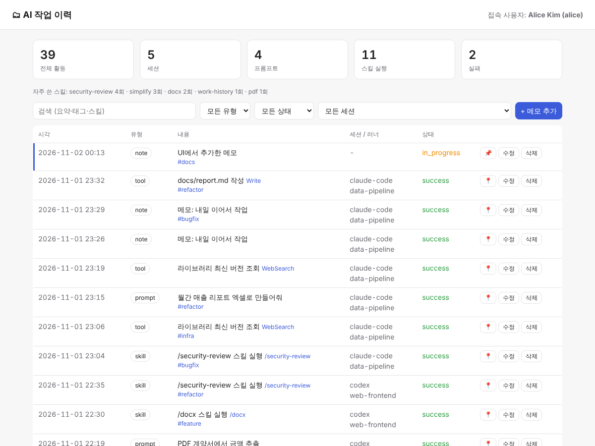

# work-history skill (sample)

A sample skill that records AI-runner usage (prompts, tool calls, skill runs) in a SQLite DB and
gives the **connected user** a web UI for managing their own history.

```
.claude/
├── settings.json                 # hooks: automatic recording (UserPromptSubmit, PostToolUse)
└── skills/work-history/
    ├── SKILL.md                  # skill definition (the runner reads this)
    ├── scripts/db.py             # schema + CLI (init/seed/whoami/log/list/stats)
    ├── scripts/seed.py           # sample data: 4 users, 23 sessions, 198 activities
    ├── scripts/hook_logger.py    # hook JSON (stdin) -> DB
    ├── scripts/server.py         # JSON API + UI server (stdlib only)
    └── ui/index.html             # management UI
```

## Quick start
```bash
cd .claude/skills/work-history
python3 scripts/db.py seed --reset                    # load sample data
python3 scripts/server.py --user alice                # http://127.0.0.1:8765 (member)
python3 scripts/server.py --user tommyhj --port 8766  # admin: can view other users
```
In Claude Code you can also just ask "내 작업 이력 보여줘" or "작업 이력 UI 띄워줘",
and the `work-history` skill runs these commands.



## Data model
| table | key columns |
|---|---|
| users | username, display_name, email, role (member/admin) |
| sessions | id (runner session id), user_id, runner (claude-code/codex/cursor…), project |
| activities | user_id, session_id, ts, kind (prompt/tool/skill/note), skill_name, tool_name, summary, status, tags, pinned |

## API
- `GET /api/me` · `GET /api/activities?q=&kind=&status=&session=&as=` · `GET /api/stats` · `GET /api/sessions`
- `POST /api/activities` · `PATCH /api/activities/{id}` · `DELETE /api/activities/{id}`
- Members can only read and change their own rows. Another user's rows return 403 or 404.

## Production notes
- Replace SQLite with Postgres or a similar shared DB, and change only `connect()` in `db.py`.
- Users are identified locally (env, git, or OS user). Shared deployments need real authentication such as SSO or OAuth.
- Hook payloads contain prompt text, so plan masking and retention policies for sensitive data.
