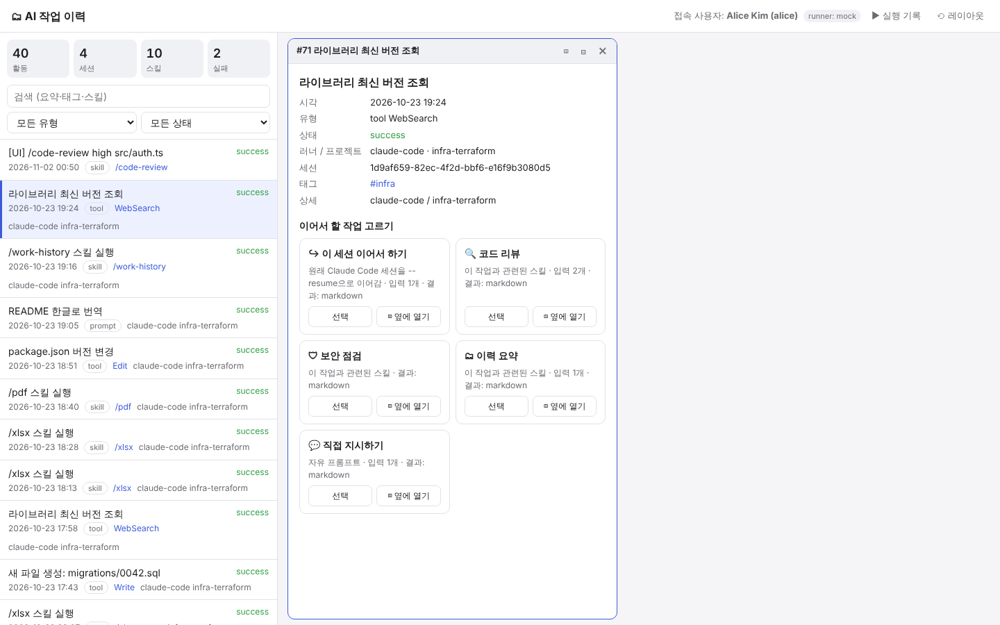
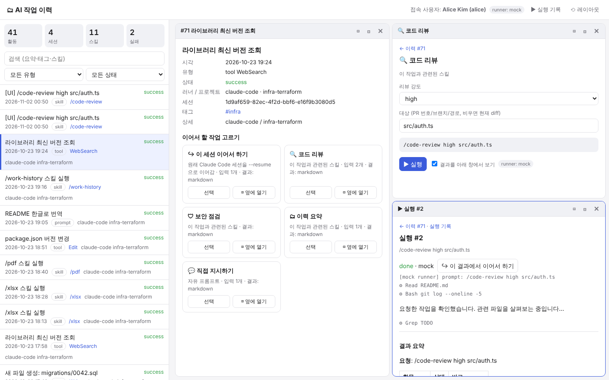

# work-history skill (sample)

A sample skill that records AI-runner usage (prompts, tool calls, skill runs) in a SQLite DB and
gives the **connected user** a web UI for managing their own history.

```
.claude/
├── settings.json                 # hooks: automatic recording (UserPromptSubmit, PostToolUse)
└── skills/work-history/
    ├── SKILL.md                  # skill definition (the runner reads this)
    ├── scripts/db.py             # schema + CLI (init/seed/whoami/log/list/stats)
    ├── scripts/seed.py           # sample data: 4 users, 23 sessions, 198 activities
    ├── scripts/hook_logger.py    # hook JSON (stdin) -> DB
    ├── scripts/server.py         # JSON API + UI server (stdlib only)
    ├── scripts/skills_registry.py# skill discovery + next-action suggestions
    ├── scripts/runner.py         # background runs: claude -p [--resume] / mock
    ├── catalog.json              # UI descriptors for skills outside this repo
    ├── ui.json                   # this skill's own UI descriptor
    └── ui/index.html             # management UI (split panes)
```

## Quick start
```bash
cd .claude/skills/work-history
python3 scripts/db.py seed --reset                    # load sample data
python3 scripts/server.py --user alice                # http://127.0.0.1:8765 (member)
python3 scripts/server.py --user tommyhj --port 8766  # admin: can view other users
```
In Claude Code you can also just ask "내 작업 이력 보여줘" or "작업 이력 UI 띄워줘",
and the `work-history` skill runs these commands.

## 클릭 → 작업 선택 → 이어서 하기 (split UI)

1. 왼쪽 이력을 클릭하면, 선택된 창에 상세와 **이어서 할 작업** 카드가 나타납니다.
   - `↪ 이 세션 이어서 하기`: 원래 Claude Code 세션을 `claude -p --resume <session_id>`로 이어감
   - 관련 스킬: 이력의 유형·도구·태그·스킬과 각 스킬의 `applies_to`를 비교해 점수가 높은 순서로 보여줌
   - `💬 직접 지시하기`: 자유 프롬프트
2. 카드를 고르면 그 스킬의 `ui.json`에 정의된 입력으로 **폼이 만들어지고**, 실제로 실행될 프롬프트를 미리 보여줍니다.
3. 실행하면 결과가 실시간으로 표시되고, 결과는 다시 이력 한 줄이 됩니다. 그 줄에서 다시 이어서 할 수 있습니다.
4. 창 머리의 ◫(좌우) / ⊟(위아래)로 영역을 원하는 만큼 나눌 수 있습니다. 경계선을 끌어 크기를 바꾸고, 레이아웃은 브라우저에 저장됩니다.




### 다른 스킬을 UI에 연결하기
스킬 폴더에 `ui.json`을 두면 됩니다. 이 저장소 밖의 스킬은 `catalog.json`에 등록합니다.
```json
{
  "label": "코드 리뷰", "icon": "🔍",
  "applies_to": {"kinds": ["tool"], "tools": ["Edit","Write"], "tags": ["bugfix"], "skills": ["simplify"]},
  "inputs": [{"name": "level", "type": "select", "options": ["low","medium","high"], "default": "medium"},
             {"name": "target", "type": "text", "default": ""}],
  "prompt": "/code-review {level} {target}",
  "output": "markdown"
}
```
`{summary}`, `{project}`, `{tags}`처럼 클릭한 이력의 필드도 템플릿에 쓸 수 있습니다. `output`은 `markdown`, `table`, `log` 중 하나입니다.

### 실행 옵션
```bash
python3 scripts/server.py --runner claude --workdir ~/code/myproj   # 실제 실행 (기본: claude가 설치돼 있으면 claude)
python3 scripts/server.py --runner mock                              # API 호출 없는 데모
WORK_HISTORY_CLAUDE_ARGS="--permission-mode acceptEdits" python3 scripts/server.py
```
`claude -p`는 비대화형이라 권한 승인이 필요한 도구는 기본적으로 거부됩니다. 파일 수정까지 맡기려면 `WORK_HISTORY_CLAUDE_ARGS`로 권한을 명시하세요.

## Data model
| table | key columns |
|---|---|
| users | username, display_name, email, role (member/admin) |
| sessions | id (runner session id), user_id, runner (claude-code/codex/cursor…), project |
| activities | user_id, session_id, ts, kind (prompt/tool/skill/note), skill_name, tool_name, summary, status, tags, pinned |

## API
- `GET /api/me` · `GET /api/activities?q=&kind=&status=&session=&as=` · `GET /api/stats` · `GET /api/sessions`
- `POST /api/activities` · `PATCH /api/activities/{id}` · `DELETE /api/activities/{id}`
- `GET /api/activities/{id}` (상세 + 추천 액션) · `GET /api/skills` · `POST /api/runs/preview` · `POST /api/runs` · `GET /api/runs/{id}?since=N` · `DELETE /api/runs/{id}` (중지)
- Members can only read and change their own rows. Another user's rows return 403 or 404.

## Production notes
- Replace SQLite with Postgres or a similar shared DB, and change only `connect()` in `db.py`.
- Users are identified locally (env, git, or OS user). Shared deployments need real authentication such as SSO or OAuth.
- Hook payloads contain prompt text, so plan masking and retention policies for sensitive data.
