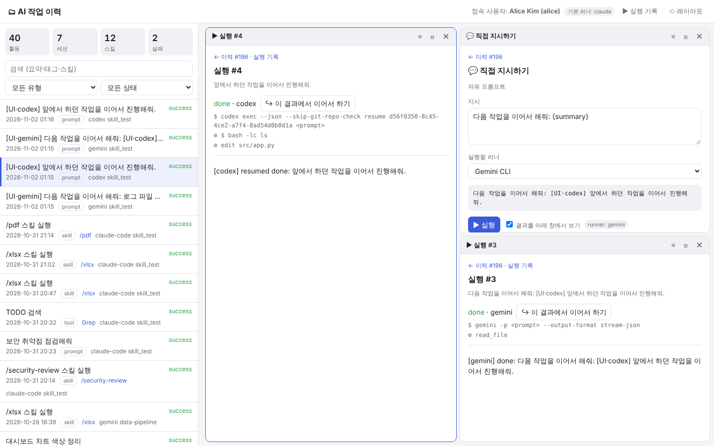

# work-history skill (runner-agnostic sample)

A skill that records AI-runner usage (prompts, tool calls, skill runs) from **Claude Code, OpenAI Codex,
GitHub Copilot CLI and Gemini CLI** in one SQLite DB. The **connected user** gets a web UI for managing
their own history and continuing work from it, on whichever runner they choose.



## Runner support

| | Claude Code | Codex CLI | Copilot CLI | Gemini CLI | Other CLIs |
|---|---|---|---|---|---|
| Skill discovery | `.claude/skills` (symlink) | `.agents/skills` | `.agents/skills` | `.gemini/skills` (symlink) | `db.py` CLI |
| Automatic recording (hooks) | `.claude/settings.json` | `.codex/hooks.json` | `.github/hooks/work-history.json` | `.gemini/settings.json` | Send the same JSON to `hook_logger.py` |
| UI run | `claude -p … --output-format stream-json` | `codex exec --json` | `copilot -p … -s` | `gemini -p … --output-format stream-json` | Add to `runners.json` (`format: text`) |
| Continue a session | `--resume <id>` | `exec resume <id>` | `--resume <id>` | `--resume <id>` | Depends on the `resume` template |
| Skill call syntax | `/skill` | `$skill` | `Use the skill skill:` | `Use the skill skill:` | `skill_syntax` setting |

- The skill source lives in one place, `.agents/skills/work-history`. Claude and Gemini use symbolic links to it.
- Every runner writes to the **same DB**.

```
.agents/skills/work-history/
├── SKILL.md                    # common skill definition (Agent Skills format)
├── runners.json                # runner adapters: run/resume command, output format, skill call syntax
├── catalog.json                # UI definitions for skills outside this repo (runners field limits where they run)
├── ui.json                     # this skill's own UI definition
├── scripts/
│   ├── db.py                   # schema + CLI (init/seed/whoami/log/list/stats)
│   ├── hook_logger.py          # converts each runner's hook payload into one record format
│   ├── runners.py              # adapters + output parsers (claude-stream / codex-jsonl / gemini-stream / text)
│   ├── runner.py               # background runs
│   ├── skills_registry.py      # scans skill folders for every runner + suggests next actions
│   ├── server.py               # JSON API + UI server
│   ├── install.py              # installs the skill and hooks into another project or user folders
│   └── seed.py                 # sample data
├── tests/                      # unit + E2E tests, fake codex/copilot/gemini CLIs
└── ui/index.html               # management UI (split panes)
```

## Quick start
```bash
cd .agents/skills/work-history
python3 scripts/db.py seed --reset                        # sample data
python3 scripts/server.py --user alice                    # http://127.0.0.1:8765
python3 scripts/server.py --user alice --runner mock      # demo without API calls
python3 tests/test_multi_runner.py -v                     # 17 tests (fake CLIs)
```

## Install into another project
```bash
python3 .agents/skills/work-history/scripts/install.py --project ~/code/myrepo                  # all runners
python3 .agents/skills/work-history/scripts/install.py --project ~/code/myrepo --runners codex,copilot
python3 .agents/skills/work-history/scripts/install.py --user                                     # links into each runner's user skill folder
```
Existing settings files are merged, not overwritten. Running it again adds nothing twice.

## UI flow
1. Click a history row. Suggested actions appear in the selected pane.
   - `↪ 이 세션 이어서 하기`: resumes the original session **on the runner that created it** (codex history → `codex exec resume`).
   - Related skills: scored by matching the row's type, tool, tags and skill against each skill's `applies_to`.
   - `💬 직접 지시하기`: free-form prompt.
2. Pick an action. A form is generated from that skill's `ui.json` inputs, with a **runner selector** and a preview of the exact prompt.
   - Automatic mode chooses: the clicked row's runner, then the default runner.
   - Explicitly choosing a runner that isn't installed or isn't allowed returns an error. It never silently falls back to another runner.
3. When a run finishes, its result becomes a new history row linked to the session. You can continue from that row too.
4. Split panes left/right (◫) or top/bottom (⊟), resize them, and the layout is saved.

## Adding a runner
Add an entry to `runners.json` (or `~/.config/work-history/runners.json`):
```json
"aider": { "label": "Aider", "bin": "aider", "run": ["aider", "--yes", "--message", "{prompt}"],
           "format": "text", "skill_syntax": "Use the {skill} skill:" }
```
Without hooks, record activity by sending a JSON record to `hook_logger.py --runner aider`, or with `db.py log`.

## Run options (environment variables)
- `WORK_HISTORY_CLAUDE_ARGS`, `WORK_HISTORY_CODEX_ARGS`, `WORK_HISTORY_COPILOT_ARGS`, `WORK_HISTORY_GEMINI_ARGS`: extra flags for each CLI. Non-interactive runs reject tools that need approval, so pass permissions here when needed. Examples: `--permission-mode acceptEdits`, `--sandbox workspace-write`, `--allow-all-tools`.
- `WORK_HISTORY_RUNNER`: the default runner.
- `WORK_HISTORY_DB`: DB path.
- `WORK_HISTORY_USER`: the user.

## API
- `GET /api/me` (user, default runner, installed runners) · `GET /api/activities?q=&kind=&status=&session=&as=` · `GET /api/stats` · `GET /api/sessions`
- `GET /api/activities/{id}` (detail + suggested actions) · `GET /api/skills`
- `POST /api/runs/preview` · `POST /api/runs {activity_id, action_id, values, runner}` · `GET /api/runs/{id}?since=N` · `DELETE /api/runs/{id}`
- `POST/PATCH/DELETE /api/activities[/{id}]`. Members can only read and change their own rows.

## Verification status
- **Claude Code**: tested with the real CLI (run and `--resume`).
- **Codex, Copilot, Gemini**: tested only with fake CLIs that print the output formats documented by each vendor. Not tested with the real CLIs.
  - Copilot `-p` output is handled as plain text, because no JSON event schema was found in its docs.
  - The Gemini CLI docs say it was replaced by Antigravity CLI. Run `--help` on the real tool and adjust the commands in `runners.json` if they differ.
  - Gemini hooks are opt-in. `install.py` sets both `tools.enableHooks` and `hooks.enabled`.

## Production notes
- Replace SQLite with Postgres or a similar shared DB by changing `connect()` in `db.py`.
- Users are identified locally. Shared deployments need real authentication such as SSO.
- Hooks record prompt text, so plan masking and retention policies for sensitive data.
