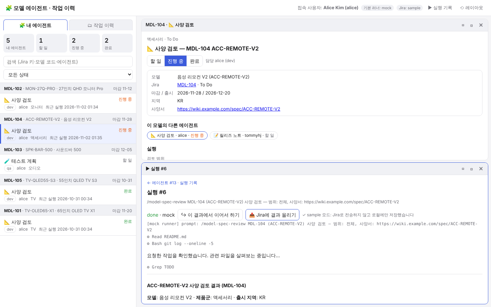

# Jira model agents → skills + per-assignee UI (sample)

When a **model** is registered in Jira, agents are created automatically for it. This sample turns those agents into
**skills** (Agent Skills format) and gives each **assignee** a UI to work with them.
It runs on Claude Code, Codex, Copilot CLI and Gemini CLI, and sample data is included so you can test without a Jira connection.



## Test it now (no Jira, no API calls)
```bash
git clone … && cd skill_test
python3 .agents/skills/work-history/scripts/server.py --demo
# → http://127.0.0.1:8765  (logged in as alice, mock runner, loads sample data on first start)
```
Try another user's view. Each user runs on a different port against the same DB:
```bash
DB=.agents/skills/work-history/data/work_history.db
python3 .agents/skills/work-history/scripts/server.py --db $DB --user bob     --runner mock --port 8766  # QA owner
python3 .agents/skills/work-history/scripts/server.py --db $DB --user jiwoo   --runner mock --port 8767  # certification owner
python3 .agents/skills/work-history/scripts/server.py --db $DB --user tommyhj --runner mock --port 8768  # PM / admin (team view, Jira sync)
```

### Things to try
1. **🧩 내 에이전트** tab: your agents, grouped by model, with deadlines.
2. Click an agent. The pane shows:
   - the model's Jira info,
   - the progress of the other agents on the same model,
   - a run form pre-filled from Jira fields (spec URL, regions, due date…).
3. Click **▶ 실행** with "결과를 아래 창에서 보기" checked. The result opens in the pane below. The agent status changes from 할 일 to 진행 중 automatically.
4. Click **📤 Jira에 결과 올리기**. In sample mode the comment is only stored locally. In real Jira mode it is posted to the issue as a comment.
5. Use the 할 일 / 진행 중 / 완료 buttons to change status. Only the assignee can do this; others can only view.
6. **Simulate a new model being registered.** This creates the 4 agents for MDL-106 automatically:
   ```bash
   curl -X POST localhost:8765/api/jira/webhook -d @.agents/skills/work-history/jira/samples/webhook_issue_created.json
   ```
7. Tests: `cd .agents/skills/work-history && python3 tests/test_jira_agents.py -v && python3 tests/test_multi_runner.py -v` (30 tests)

## Sample data
| Jira | Model | Product line | Agents created (assignee) |
|---|---|---|---|
| MDL-101 | TV-OLED65-X1 | TV | spec review (alice) · test plan (bob) · cert (jiwoo) · release note (tommyhj) |
| MDL-102 | MON-27Q-PRO | 모니터 (Monitor) | same 4 |
| MDL-103 | SPK-BAR-500 | 오디오 (Audio) | same 4 (dev bob, QA alice) |
| MDL-104 | ACC-REMOTE-V2 | 액세서리 (Accessory) | **spec review and release note only**, per the product-line rule |
| MDL-105 | TV-QLED55-S3 | TV | mostly done, with sample results |
| MDL-106 (webhook) | MON-32S-M8 | 모니터 (Monitor) | created at registration time |

- The Jira data is in `jira/samples/jira_search_response.json`, which uses the Jira Cloud REST v3 response format.
- tommyhj's email is hidden in the sample data, as Jira Cloud often does. That user is matched by accountId instead.

## Structure
```
.agents/skills/
├── model-spec-review/      ┐ Converted agents (one skill each)
├── model-test-plan/        │   SKILL.md          instructions for the runner (gets model info via jira_sync.py show)
├── model-cert-check/       │   ui.json           UI form (inputs prefilled from Jira fields, prompt, owner role)
├── model-release-note/     ┘   examples/sample_output.md   sample result (used by the mock runner)
└── work-history/
    ├── jira/
    │   ├── jira_mapping.json      Jira custom field ids → model fields, role → person field
    │   ├── agent_templates.json   which agents are created for a model (rules per product line)
    │   └── samples/               sample Jira search response + webhook payload
    ├── scripts/
    │   ├── jira_sync.py           Jira → models/agents (sample | REST), comment write-back, webhook
    │   ├── server.py              UI + API (my agents, run, status, Jira comment, webhook, sync)
    │   ├── runner.py · runners.py run on each runner (claude/codex/copilot/gemini/mock)
    │   ├── hook_logger.py         records work history automatically from each runner's hooks
    │   ├── install.py             installs the skills and hooks into another project
    │   └── db.py · seed.py        DB schema, sample data
    ├── tests/                     30 tests (fake Jira server, fake CLIs)
    └── ui/index.html
```
For Claude Code and Gemini, `.claude/skills/*` and `.gemini/skills/*` are symlinks into `.agents/skills`. Codex and Copilot read `.agents/skills` directly.

## Connecting your real Jira
1. **Map the fields** in `jira/jira_mapping.json`:
   - Set the model code, product line and other fields to your custom field ids. You can look them up with `GET /rest/api/3/field`.
   - Set the person field for each role.
   - If emails are hidden, map accountId to username under `users`.
2. **Choose which agents to create** in `jira/agent_templates.json`, by role and by product line.
3. **Set connection details** in environment variables:
   ```bash
   export JIRA_BASE_URL=https://your.atlassian.net JIRA_EMAIL=bot@company.com JIRA_API_TOKEN=…   # Cloud
   # Server/DC: JIRA_BASE_URL=https://jira.company.com JIRA_PAT=… JIRA_DEPLOYMENT=server
   python3 .agents/skills/work-history/scripts/jira_sync.py pull          # first import
   ```
4. **Automatic creation:** add a Jira webhook (Issue created / updated, JQL `issuetype = Model`) pointing to `https://<server>/api/jira/webhook?secret=<JIRA_WEBHOOK_SECRET>`. The server must be reachable from Jira.
5. **Real runs:** start without `--runner mock` and the first installed runner (claude, codex, …) is used. Run permissions are set with `WORK_HISTORY_<RUNNER>_ARGS`.

## Adding a new agent
1. Create `.agents/skills/model-<name>/` with `SKILL.md`, `ui.json` (`"agent": true, "role": "..."`) and `examples/sample_output.md`.
2. Add `{"skill": "model-<name>", "role": "..."}` to `jira/agent_templates.json`.
3. Run `jira_sync.py pull` (or wait for the webhook). The agent is created for existing models too.

## Multi-runner support
| | Claude Code | Codex CLI | Copilot CLI | Gemini CLI |
|---|---|---|---|---|
| Skill folder | `.claude/skills` (link) | `.agents/skills` | `.agents/skills` | `.gemini/skills` (link) |
| Automatic recording | `.claude/settings.json` | `.codex/hooks.json` | `.github/hooks/work-history.json` | `.gemini/settings.json` |
| Run / continue | `claude -p` / `--resume` | `codex exec --json` / `exec resume` | `copilot -p` / `--resume` | `gemini -p` / `--resume` |

Add other CLIs in `runners.json`. To install into another project: `python3 .agents/skills/work-history/scripts/install.py --project <path>`.

## Verification status and limits
- **Tested:**
  - Sample data, webhook and UI flows (browser).
  - Jira REST pull with pagination and auth headers, and ADF comments, against a fake Jira server.
  - Claude Code real runs on the history flow.
- **Not tested:**
  - Calls to a real Jira instance.
  - Running the agent skills with a real LLM (the demo uses the mock runner).
  - Real CLIs other than Claude Code.
- **Local use only:** the server is meant for one person on their own PC (127.0.0.1, user given by a startup option). Shared deployment needs SSO, an ingestion API and a local runner on each PC. See the previous discussion.
